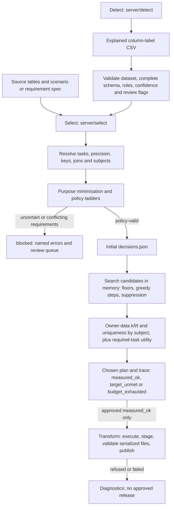

# Detect + Select combination

The combined backend is on **main**. Detect lives in `server/detect`; selection modules live directly in
**`server/select/`** and import as `server.select.*`; the redundant `privacy_tool/` package layer is gone.
The original selection worktree and unrelated client edits are preserved. Nothing is committed yet.

## Current flow



The handoff is an artifact boundary. `select --labels` **does not instantiate or train Detect v3**.
Without `--labels`, the earlier lightweight detector remains a fallback. `select` and `search` write
decisions and explanations; neither writes protected tables or private row maps.

## What is connected

| Part | Current behavior | Expected contract |
|---|---|---|
| Detect labels | Reads the explained CSV exported by Detect v3/v2/v1 | `dataset,table,column,privacy_role,subtype,confidence`; optional `needs_review,art9,art9_table` |
| Schema and dataset | Filters the requested dataset, rejects duplicates, unknown/missing columns and invalid confidence/flags | Labels must cover exactly the input columns; dataset matches the data-directory name |
| Review | Honors `needs_review` even at high model confidence | Preserve the original confidence/flag; use conservative effective confidence until explicit `--confirm` review |
| Explanations | Does not copy detector free-text reasons, samples or probability dumps | Selection artifacts must not contain source values or LLM-quoted identifiers |
| Art. 9 | Retains flags and uses table context conservatively; rejects contradictory Art. 9 roles | Sensitive/free-text flags must agree with the privacy role; uncertainty cannot silently weaken policy |
| Requirements and relations | Resolves scenario/spec tasks and precision; recomputes joins and subjects from source tables | Preserve main's protection-downgrade guard and blocking relation conflicts; no invented identities |
| Policy | Chooses role/subtype/trust ladders, minimises unused fields and scopes shared HMAC domains | Identifiers never KEEP; required uncertainty yields a protective plan or actionable block |
| Search | Probes floors, greedily coarsens and supports local suppression; ≤50 evaluations and ≤2% suppression allowance | Deterministic trace, chosen evaluation, utility-rejected rungs and named conflicts; never lower targets |
| Metrics | Uses `pets_eval.privacy`, counted by distinct subject contributions | When t is a target, check each candidate; otherwise measure t on the chosen plan |

Selection previews and the final export share one implementation, `server/actions.py`, which includes
subject resolution, local suppression and hour-preserving rungs. `server.transform` is the only export
path. `python -m server.select transform` delegates to it.

## Run the combination

Use the challenge package's `.venv` Python; `pets_eval`, pandas and numpy must already be installed.
Detect's additional dependencies are listed in `server/detect/requirements.txt`.

1. Prepare an explained Detect label artifact. The existing development command, from `server/detect`, is
   `python -m pets_detect_v3 --root <package-root> detect --datasets health --no-llm --out <fresh-labels.csv>`.
   This is currently a **training/development path**, with the catalog dependency described below.
2. From the repository root (`src/`), build the initial plan:

   ```bash
   python -m server.select select --data <package-root>/data/health \
     --scenario HEALTH-S1 --labels <detect-out>/labels.csv --out <fresh-plan-dir>
   ```

3. Resolve any named required-label blocks through reviewed `--confirm` labels. Then measure the plan:

   ```bash
   PRIVACY_TOOL_HMAC_KEY=... python -m server.select search \
     --data <package-root>/data/health --plan <fresh-plan-dir>/decisions.json \
     --budget 50 --out <fresh-search-dir>
   ```

Use fresh directories for every run. `policy_valid` is an initial plan, not measured privacy success and never
an approval. Search exits 0 for `measured_ok` (the only `outcome.approved: true`), 3 for `target_unmet` (allowed
candidate space covered) and 4 for `budget_exhausted` (unexplored candidates remain; not a proof of
infeasibility); `blocked` and rejected artifacts exit 2. See README.md for the issue codes and `outcome` block.
No training catalog, `truth/` or gold spans are needed by selection.

## Gaps and expectations

| Gap | What remains / expected behavior |
|---|---|
| Detector deployment | Detect v3 currently loads `metadata/field_catalog.csv` and training profiles in its constructor. It needs a separately trained, frozen model/vocabulary loader before serving catalog-free production inference. Selection consumes saved labels and must not invoke that training path. |
| Artifact provenance | `select --labels` requires the contract-v1 manifest and rejects other input bytes, labels or dataset revisions by name; `search` re-checks the plan's input digests and records `plan_sha256`. The legacy built-in detector path is marked unbound. |
| Spans and linkage | Selection validates `spans.jsonl`/`linkage.json` (`stale_span`, `missing_span_evidence`, `ambiguous_join`, `ambiguous_subject`) and keeps only counts/ids. Selection still recomputes its own joins and distinct-subject risk; detector row-count risk is not a substitute. Transform reads the same `spans.jsonl` through `--detect <dir>`, re-checking the manifest, `span_id` and offsets against the input bytes. |
| Confidence and subtype coverage | Every emitted and vocabulary (role, subtype) pair maps to a protective policy or `unsupported_label` (DROP + review; blocks when required). Unconfirmed uncertain required labels block with `review_required`. The statistical detector's subtype quality is not established by schema validation alone. |
| HEALTH-S1 privacy | The prior 50-evaluation selection result remains `target_unmet`: 12.98% of known visit subject/class contributions below k=5, l failures, and missing subjects in 921 visits / 2,205 linked lab rows. More search does not repair missing identities. These figures are historical selection evidence, not a fresh Detect-v3 benchmark. |
| UI/API | The frontend still uses local/static data and browser-side services. This combination connects backend Python stages through files; a backend API and frontend wiring are not implemented here. |
| Release approval | A valid/exportable plan is not evidence that privacy targets are met. Do not present a `target_unmet` result as an approved release. Budget exhaustion is not a proof that every plan fails. |

## Transform stage

Implemented as `server.transform`; see the central README and [server/transform.md](server/transform.md).
It exports only `measured_ok` plans and validates the written files before it publishes them. For
HEALTH-S1 it currently produces refusal diagnostics.

## Validation

- Before integration, main's existing selector suite: **156 passed**.
- Combined detector/selector suite: **248 passed** (`../.venv/bin/python -m pytest` from `src/`).
  The detector tests use fake localhost LLM servers, so the full run required permission to bind a local port.
- Tests cover the CSV handoff, high-confidence review flags, invalid schemas/confidence/Art. 9 flags,
  raw-reason exclusion, no-export selection, preview time boundaries and bounded deterministic search.
  Main's newer downgrade and relation-conflict tests remain intact.
- Fresh Detect-v3 training/LLM benchmarking and transformation exports were not run for this integration.
- A fresh full-data saved-label handoff on main completed **50 search evaluations in 113.3 seconds**,
  using all 46,398 visit rows and 130,341 lab rows. All five utility scores remain ≥0.9978; the same named
  `target_unmet` conflicts remain. Runtime guards prohibited catalog/truth/gold-span reads. No exports ran.
  This validates the relocated selection with historical labels, not a new Detect-v3 prediction benchmark.
  Evidence: [integration validation](../outputs/main-detect-select-20261107T120454Z/integration_validation.json)
  and [chosen plan/trace](../outputs/main-detect-select-20261107T120454Z/search/decisions.json).

The central operating guide is [README.md](README.md). The final stage and output contract are planned in [server/transform.md](server/transform.md).
