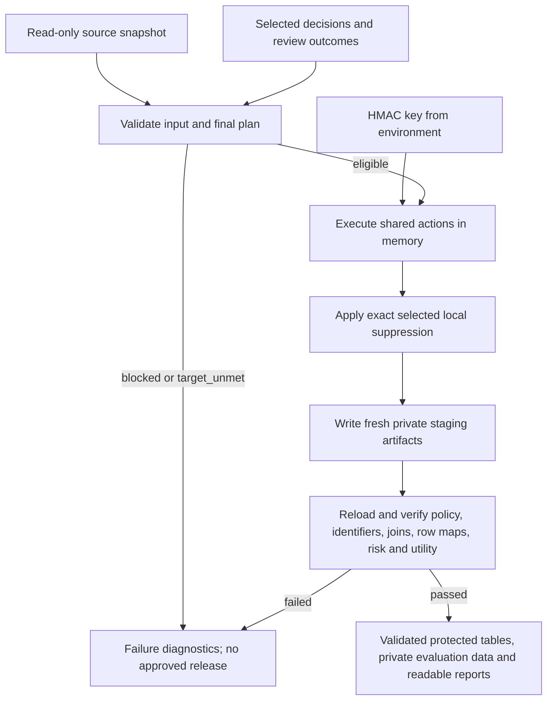

# Final stage plan: Transform and format the output

**Status: planned, not implemented by this document.** Detect and measured selection are already connected.
This stage turns a final selection into validated, consistently formatted artifacts. It must not change
the selected protections or claim privacy success for an unmet plan. Operational instructions belong in
the central [README](../README.md); integration gaps are recorded in [combination.md](../combination.md).

## 1. Scope and starting point

- Source tables remain read-only. Consume selected actions/parameters, derivations, joins/domains,
  suppression rules, requirements, measured targets and review decisions from `decisions.json`.
- Reuse the existing pure operations in `select/transform.py` and `select/preview.py`. The prototype lacks
  the preview's hour-preserving rungs, subject-based local suppression and Detect's span/entity integration.
- Create the final stage directly under `server/transform/`, without another package layer. Use
  `python -m server.transform` from the repository root. The existing selection CLI's export guard stays
  until the final executor supports the selected operations.
- Establish one shared pure action implementation, initially a flat `server/actions.py`, used by selection
  previews and final execution. Keep file writing, row maps and reporting in the Transform stage. Move
  existing operations rather than duplicating or redesigning the policy matrix.
- Keep CSV, JSON and Markdown as the required formats. Reuse toolkit HTML scorecards where needed;
  no new spreadsheet formats, UI, dependencies, DP or synthetic-data path is required.



## 2. Preconditions and failure rules

1. Validate the plan version, schema, all column decisions, derived-column collisions, allowed methods,
   parameter ranges, join domains and selected suppression budgets. Reject unsupported operations before writing.
2. Approved release export requires `measured_ok` and no unresolved review issue affecting a released/required
   field. `ready_for_transform` only means policy-valid. `blocked` and `target_unmet` produce diagnostics,
   not a directory represented as an approved release. Dropped-only review items remain informational.
3. Bind Detect/Select artifacts to the source revision. The current schema/row-count fingerprint cannot
   detect changed values. Extend the handoff with an owner-private input digest/revision and verify it
   before execution. Older plans without this binding require regeneration or full current-input
   validation; do not assume unchanged column names mean unchanged data.
4. Require a non-empty environment key and an explicit recipient-scoped `release_id` for HMAC. No key,
   identifier/token map, raw text or private row map belongs in public decisions, manifests or logs.
5. Refuse an existing output directory, overlap with source directories, and unsafe table-derived paths.
   Reserve a new run directory exclusively. Build private staging output and mark/publish the release
   as validated only after every required check passes. On failure preserve diagnostics/staging privately;
   do not overwrite, discard or automatically delete data to retry.
6. Missing subject IDs remain unresolved. Do not invent one person per row, merge missing people into one
   person, remove source rows or relax k/l/t to make the run succeed.

The default HEALTH-S1 plan currently remains `target_unmet`; refusal/diagnostics is its expected release
behavior until its missing identities and privacy/utility conflicts are resolved.

## 3. Action execution order

1. Read columns as strings with explicit blank handling, preserving identifier leading zeros and source row order.
2. Resolve subjects through validated, unique-parent joins and the declared subject mapping. Normalize IDs
   exactly as HMAC does; ambiguous parents and missing IDs stay unresolved.
3. Derive age from the original birth/event dates before either field is generalised or dropped.
4. Execute the exact selected rung for every column: KEEP, DROP/WITHHOLD, HMAC, generalisation or redaction.
   Do not pick a different rung, threshold or domain inside Transform.
5. Apply the selected local QI suppression using distinct subjects and the same class-key semantics as search.
   Recompute its row counts and enforce the ≤2% allowance per affected table and overall. Suppression blanks
   selected QIs; it does not delete rows. Fail if execution differs from the measured plan.
6. Construct retained source columns in their original order, followed by declared derived fields. Withheld
   tables and dropped columns have no exported data file/column. Keep private row maps aligned with this order.

### Semantics to preserve

| Action | Required behavior |
|---|---|
| HMAC | HMAC-SHA-256, 32 hex characters, existing release/domain context, matching join tokens; blanks stay blank |
| Time | Floor, never round; preserve `HH:00` for hour-preserving rungs and ISO week/date meaning at boundaries |
| Year/week/month + hour | Use the chosen anchor representation and describe its generalised precision in the manifest; it is not the original event date |
| Age | Original-date derivation; selected width/top code; exact birth date absent from release |
| Codes/numbers | Toolkit parsing and selected mappings/rounding; unparseable/unmapped values become blank and are counted, never copied raw |
| Rare categories/suppression | Same counts, replacement, thresholds and subject identities as the measured preview |
| Free text | Consume local Detect spans/entity IDs tied to the source revision; consistent entity/domain pseudonyms when selected, otherwise typed redaction placeholders; validate offsets and reject stale spans |
| No valid span mapping | Do not silently KEEP unredacted text; use only the explicitly selected safe redaction/withhold behavior, or block for review |

## 4. Output layout and formatting

```text
<fresh-run>/
  decisions.json                  exact selected protections and final status
  decisions.md                    readable version of those decisions
  manifest.json                   version, release context, validation status and file/schema inventory
  transform_stats.json            row/column counts, parse losses and suppression counts
  protected/                      recipient-facing data only
    <table>.csv
  evaluation/                     owner-private; never distribute with protected/
    <table>.csv                   identical data for toolkit scoring
    rowmap_<table>.csv            protected_row,original_record_id
    input_manifest.json          source revision/digests and private provenance
  reports/
    summary.md                    utility, risk, limitations and remaining review items
    identifier_check.json         raw scan counts plus investigated classifications; no raw examples
    scorecard.json                toolkit assessment
    scorecard.html                toolkit rendering when generated
```

`protected/` is the only data directory intended for the recipient. `evaluation/` must be a sibling,
not nested inside it. Reports/manifests must be checked for private contents before distribution; a
directory name or successful process exit is not a privacy guarantee.

### Formatting contract

- CSV: UTF-8, header row, comma delimiter, normal CSV quoting for commas/newlines/quotes, and no pandas index.
  Preserve original table/retained-column names. Represent missing/unparseable values as empty fields;
  never accidentally write `nan`, `None` or `NaT` strings. Re-read with the same string/blank contract.
- Dates/times: use the selected canonical formats already understood by the toolkit, including ISO dates,
  `%G-W%V` weeks and `YYYY-MM-DD HH:00`. Derived age bands use canonical labels such as `0-9` and `80+`.
- Numbers: locale-independent decimal notation matching existing formatters and selected precision.
  Do not introduce extra rounding in the file writer. IDs and tokens remain strings.
- Row maps: exactly `protected_row,original_record_id`; zero-based protected positions; original IDs
  preserved as strings. One aligned mapping per released table. No maps for withheld tables.
- JSON: stable key/table ordering, readable indentation, a format version and valid JSON values only
  (no NaN/Infinity). Use relative output paths and safe counts/metadata; omit keys and raw source values.
- Manifest: distinguish selection status from post-export validation status. Include release/scenario,
  targets, table/column inventory, output checksums, generalisation semantics and checks performed.
  Keep source digests/provenance in the private input manifest, not in the recipient-facing inventory.
- Markdown/HTML: concise tables for chosen actions, utility versus its baseline, k/l/t, unresolved subjects,
  parse losses and suppression. Escape source-derived labels. Do not render raw identifiers, text or row maps.

## 5. Validate the serialized result

1. Reload the written CSVs. Verify headers, table scope, row counts/order, derivations, blank handling,
   evaluation-copy equality and exact row-map alignment against the source snapshot.
2. Check shared HMAC joins and original orphan behavior. Verify all selected actions and suppression counts
   agree with the preview, including missing/normalized subjects and composite class keys.
3. Re-measure owner-data k/l/t and uniqueness on the serialized tables and the required utility tasks at the
   same τ/baseline. Unknown subjects or target/utility failures prevent a validated release. Never use
   benchmark adversary outputs to revise selection.
4. Run `pets-eval check` on **all lines of protected files only**. Inspect its JSON totals: the CLI can exit
   successfully even when identifiers are reported. Investigate each category before declaring the scan clean.
5. Treat phone-like substrings inside generated, validated HMAC tokens as classified scanner false positives,
   not as a reason to disable phone checks globally. Preserve scan counts and the classification evidence,
   without writing raw matches in the shareable report.
6. Generate the toolkit scorecard and readable summary. Any adversary evaluation belongs only in the final
   report and must not feed back into selection. Mark unrun checks explicitly.

## 6. Implementation sequence and checks

| Step | Change | Evidence required |
|---|---|---|
| 1 | Version/source binding and preflight; define the approved-release gate | Reject stale schema/values, uncertain required fields, bad paths/params, missing key and non-measured plans before export |
| 2 | Consolidate pure operations and add missing rung/suppression semantics | Selection preview and executor match on every policy method; existing tests remain green |
| 3 | Integrate Detect span/entity artifacts and typed redaction | Validated offsets, consistent mentions, and no fallback to raw text |
| 4 | Write canonical CSV/JSON/Markdown plus separate private row maps | Reloaded schema/values/order round-trip; no raw/private material in public metadata |
| 5 | Serialized risk/utility and identifier validation; publish status/manifest | Positive synthetic release plus explicit full-data HEALTH-S1 refusal/conflicts if targets still unmet |
| 6 | Complete report and CLI wiring; delegate the legacy export command to the one final executor | No duplicated execution path; concise documentation and current validation evidence |

Tests must include: quoted/multiline CSV, leading-zero IDs, blank/malformed values, late-night and ISO-year
time boundaries, age derived before dropping dates, shared joins and orphans, repeated/unknown subjects,
numeric/categorical mappings, ≤2% suppression, withheld tables, stale spans, keys absent from artifacts,
failed checks/partial writes, existing-output refusal, and scan hits with both true positives and HMAC false positives.

Run the full detect/select/transform test suite. Validate successful export on artificial fixtures whose
targets genuinely pass, and test the actual HEALTH-S1 `target_unmet` gate on all rows. Do not lower targets
or remove records to create a passing demonstration. A successful full-data release can only be claimed
after the owner resolves the actual data/precision conflicts and reselects a passing plan.

## 7. Done when

One executor supports every selected operation and produces the documented artifact layout. Serialized
values match preview semantics; policy, joins, row maps, identifiers, risk and utility checks pass for a
valid plan. Unsafe or unmet plans fail with actionable diagnostics and no approved release. The manifest
and human report state exactly what was checked and what remains unresolved. Sources and keys remain protected.
